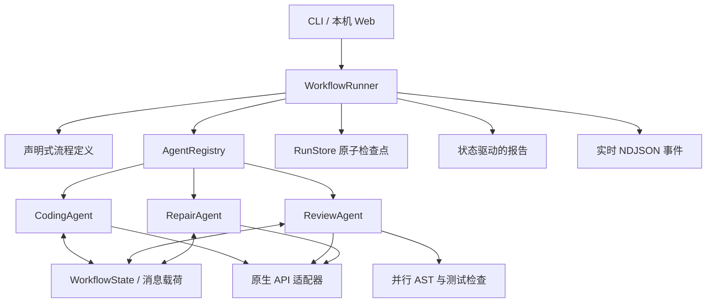

# AgentCoder 设计文档

## 跨运行的版本继承

“从失败节点继续”恢复同一运行的检查点。“继续迭代”创建新的运行 ID，显式记录 `parent_run_id`、`origin`、父源码版本与 SHA-256。父运行必须已经结束并提交源码；父记录保持不变。

继承源码逐字传给编码节点，并保留为首次交付，编码节点为新增要求补充测试，审查节点据此决定是否修复。父运行及更早迭代的冻结测试以独立 `test_inherited_*.py` 文件原样交付，最多保留 16 组；控制器通过 `unittest discover -p 'test*.py'` 同时执行旧测试和新增测试。检查点核对继承源码及每组测试的哈希，交付 ZIP 也包含这些文件。

网页在启动前显示代码来源、测试执行模式与修复预算。静态审查不会被报告为实测通过。执行时间、响应信号和草稿更新当前状态区，关键交接记录单独保留，避免等待事件刷满列表。

AgentCoder · Homework 2

## 目标与范围

以编码、审查、修复三个 Agent 完成单模块软件交付，展示顺序编排、消息交接、共享状态、条件路由和有界循环。真实模式调用原生 LLM API；离线模式使用固定教学 Agent，提供可重复的完整演示。实现、测试、消息和审查报告均可查看。

## 组件

角色实现、流程路由、模型协议和存储彼此分开。CLI 与 Web 使用同一控制器。定义中的 `agent` 名称由注册表解析，`kind` 决定如何提交节点结果；新增观察节点无需修改模型接口。默认节点为三类 Agent，扩展测试接入第四个审计观察者，验证接口可扩展。

## Agent 通信

编码 Agent 交付完整模块与测试，控制器将它们写入共享产物，并产生 `code_ready` 消息。审查 Agent 读取相同源码和冻结测试，提交 `review_result`，包含确认问题与实际测试状态。修复 Agent 读取该消息及共享代码，提交 `repair_ready`，携带前后代码哈希和原测试哈希。

消息格式为 `{seq,time,sender,recipient,kind,payload}`，保留有序日志。角色不直接操作彼此对象，输入通过共享状态和消息提供；结果由控制器校验并提交。多个角色可以使用同一模型，但系统提示、结构化输出工具和职责独立。

## 控制流与状态

运行状态为 `created → running → completed`；失败进入 `failed`，停止进入 `cancelled`，达到预算进入 `exhausted`。节点状态为 `pending/running/completed/failed/skipped`。`phase` 指向下一个待执行节点，`cycle` 只在修复代码提交后递增。

审查通过沿 `next` 路由走向交付，失败沿 `revise` 路由进入修复。实际测试失败、语法错误或经核验的问题都会阻止通过。默认最多修复三轮，可设 1–5 轮；另有每次最多 40 次节点执行的兜底预算。达到上限保留最后的失败事实，不伪装成功。

审查内部使用两个线程并行执行 AST 和 unittest 检查，再合并结果给审查 Agent；三个角色之间仍按显式路由顺序交接。共享运行由 Web 活跃运行表防止重复恢复，同一运行只允许一个请求执行。所有运行状态的提交在执行线程中完成。

## 原始测试与证据

编码后保存 `baseline_tests`；每次状态校验要求 `test_solution.py` 与其逐字相同。修复工具只返回 `solution` 和公开摘要，不能返回测试文件。可选原始模块在编码阶段保留，以便由独立角色审查，而不是被编码节点先消除问题。

模型发现必须包含实际行号和完整源码引文，引用必须出现在对应位置附近。无效引用会使当前节点失败并保留检查点，不能生成可信发现。静态规则只作为候选传入模型，报告与通过门禁区分模型结论、语法事实和实际测试状态。测试通过不能证明全部正确性。

## 检查点与恢复

每个运行使用随机 32 位十六进制 ID 和独立目录。`state.json` 使用临时文件与原子替换保存，包含图定义、当前节点、产物、消息和事件；不含 API Key。模型请求失败时不会提交该节点的新产物，已完成节点继续保留。

恢复加载检查点并校验版本、状态、路由、产物名和冻结测试；从 `phase` 继续。节点结果提交之前的失败可能导致该节点重做一次，采取至少一次语义；提交后的节点不会重新生成代码。取消令牌在节点交接和模型流活动时检查。模型正在等待或测试执行中，停止要等当前操作退出；测试有超时。

## API 与网页

沿用作业 1 的标准库原生接口适配、错误脱敏、SSE、DPAPI 和 Markdown 渲染。两种接口使用各自原生函数工具 schema，通过命名工具选择提交 Agent 结果；所有返回数据在本地再次校验。Responses 保留原生协议项，Chat Completions 按索引合并工具参数分片。

接口实现参考 [OpenAI Function Calling](https://developers.openai.com/api/docs/guides/function-calling) 和 [Streaming Responses](https://developers.openai.com/api/docs/guides/streaming-responses)。隐藏推理内容保留在适配器协议状态中，不进入运行消息、状态或界面；页面只显示公开执行事件和角色摘要。

Web 绑定 `127.0.0.1`，检查 Host、随机请求令牌和 JSON 请求大小。`/api/run`、`/api/resume` 逐条输出 NDJSON 的 run/event/result 帧；前端实时展示节点、分支、耗时与事件，完成后渲染报告、代码、测试和消息。历史状态在重启后可读取。

模型设置验证成功后才覆盖本机保存文件。Windows 使用当前用户 DPAPI；其他系统用 `0600` 私有文件权限。密钥不向浏览器回传，不放在 localStorage/sessionStorage，配置与运行文件被 Git 和提交包排除。密钥变更后可恢复失败的真实模型节点。

## 执行边界

原始文件只读；输出固定为两个 Python 文件、状态、报告与证据，写入本项目专用运行目录。源文件仅接受 UTF-8 `.py`，上限 64 KiB，拒绝配置和内部目录。报告以 DOM 节点渲染，原始 HTML 保持文本，链接只允许 HTTP(S)。

测试执行需要真实模式显式开启，内置离线示例属于可信样例。用参数数组启动标准库 unittest 子进程，清理 API 等环境变量，限制十秒与输出大小，并清理超时进程树。测试仍具有当前用户权限，不是安全沙箱。当前不提供公网部署、跨语言测试、自动写回原仓库或任意多文件项目修复。

## 流程编辑、代码版本与验收

网页编排支持模板、节点路由选择和 JSON 导入；`GraphStore` 原子保存本机定义，每个新运行深拷贝该定义。`validate_graph` 检查唯一编码 / 审查节点、修复复审回路、观察节点可达性及无出口循环。通过路径必须到达交付，编码不能绕过审查，修复不能重新进入编码。内置绑定在网页启动前检查；CLI 可使用可信代码注册自定义 Agent。编排是受约束的 MVP，不是通用任意 DAG 调度器。

编码和修复提交各保存一份 `revisions`：序号、修复轮次、节点、时间、完整源码、源码 / 冻结测试 SHA-256、交接消息序号及公开摘要。审查结果关联当前版本号与源码哈希。`evidence.py` 使用真实快照生成 unified diff、逐轮测试变化和按事件时间累计的节点耗时。读写检查点时核验快照哈希、冻结测试及当前产物一致性；哈希用于一致性检查，不是对抗本地恶意修改的数字签名。

旧版状态继续支持 version=1；缺少快照的历史完成记录明确说明先前源码不可重建。旧失败节点恢复时，只记录已知的当前源码，标为 `legacy_checkpoint`，不伪造原始版本。新版本从当前节点继续追加快照，冻结测试不变。

验收指标 `verified` 需要流程完成、最终源码与审查匹配、原始测试一致及实际测试 `passed`。只完成静态 / 模型审查为 `unverified`；失败、取消、预算终止为 `unfinished`。控制器对自定义审查实现也执行语法、确认问题与实际失败门禁。观察节点得到状态副本，修改副本会失败并保留真实产物；其公开日志可经 context 发出。插件是可信 Python，不构成进程隔离。

`/api/runs/<id>/bundle` 从该次状态生成白名单 ZIP，包含两个 Python 文件、报告、状态、证据、流程和复现说明；读取邻近目录和本机设置不参与打包。执行中的运行暂不能下载，以免导出不完整交接。用户可在独立目录重跑冻结 unittest。

## 多场景验收

网络取消、流式兼容、公开草稿、工作目录及测试输入绑定的设计与边界见 [RELIABILITY.md](docs/RELIABILITY.md)。套接字 IO 与状态写入分离；纯回归测试不会再当成被测源码保留。公开仓库使用通用项目标识，个人提交包名仅通过本机打包参数指定。

`python -m agentcoder evaluate` 使用三个可信样例、规则 Agent 和真实 unittest 验证十种流程行为，含暂时中断、无效修复和错误批准故障注入。预算终止和未运行测试按各自预期判断；10/10 指的是编排行为通过，不是 LLM 检测准确率或任意任务成功率。Linux / Windows × Python 3.10 / 3.13 的 CI 每次重新生成可下载的 JSON 与 Markdown 证据。真实模型报告作为独立证据，不混入离线统计。

## 与作业 1 的关系（复用范围）

复用配置、模型协议、Python AST、密钥保护、本地选择器和 Markdown 渲染，并修正选择器模块名。新增部分包括三类角色、声明式图、注册表、状态与消息、循环门禁、恢复机制、协作报告和可视化执行界面。两个项目在独立目录与仓库中保留，作业 2 运行无需安装作业 1。
