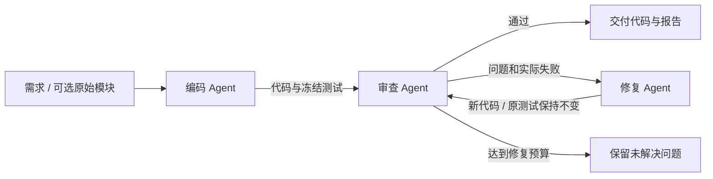

# AgentCoder

多智能体合作的代码审查工作流，完成 Homework 2 的“编码 → 审查 → 修复”方向。三个 Agent 各自有独立角色、提示和输出协议，通过消息与共享状态交接代码、审查证据和修复结果。

项目：[dankingzzzing/AgentCoder](https://github.com/dankingzzzing/AgentCoder)

## 快速运行

需要 Python 3.10 或以上，应用仅使用标准库，不需要模型 SDK、LangChain 或 Web 框架。从项目根目录运行：

```powershell
python -m agentcoder demo
python -m agentcoder serve
```

打开 [http://127.0.0.1:8767](http://127.0.0.1:8767)。首次使用可以配置模型，也可直接选择“离线演示”。点击“开始协作”，观察编码交付、审查发现、修复交接和复审通过。演示固定包含四处契约缺陷和八个回归测试，默认执行可信的内置测试。

网页保存的模型设置在刷新和重启后恢复。Windows 密钥通过当前用户 DPAPI 加密保护；输入框留空表示沿用，不是没有保存。其他系统使用 `0600` 私有文件权限保护。设置位于 `.agentcoder/web-settings.json`，不写入浏览器存储、GitHub 或提交包。

实际界面与过程：


[48 秒演示视频](docs/assets/demo.mp4) · [真实模型工作流报告](docs/samples/real-workflow-report.md)

## 协作流程



| Agent | 输入 | 职责与交付 |
| --- | --- | --- |
| 编码 Agent | 用户任务、可选初始模块 | 实现 `solution.py`，生成 `test_solution.py`，交给审查节点；已有源文件会保留原代码进入审查 |
| 审查 Agent | 完整源码、冻结测试、AST 候选、实际测试状态 | 核验问题的行号和源码引文，决定通过或进入修复 |
| 修复 Agent | 审查消息、代码、失败测试、功能契约 | 只修复 `solution.py`，保留原始测试，再交回审查 |

顺序执行由工作流控制器负责；审查内部的 AST 检查与 unittest 检查可以并行。正确模块走直接通过分支，缺陷模块进入有上限的修复循环。模型不能直接控制流程状态，实际测试失败会否决模型的“通过”结论。

**离线演示是明确标注的三个规则 Agent，不调用 LLM，只支持固定教学样例。** 真实模式由三个独立提示的模型 Agent 协作；它们可以使用同一个模型和 API Key，不需要购买三个模型账号。

## 配置真实模型

网页点击“模型设置”，输入 API Key、支持工具调用的模型名和服务地址，点击“验证并进入”。验证会检查真实工具调用与结果回传。第三方兼容服务默认使用 Chat Completions；OpenAI 官方地址默认使用 Responses，也可手动选择。

在真实模式下填写任务。可以从“本地 Python 模块”选择 `.py` 文件或粘贴源码；原文件只读，所有生成物写入独立运行目录。当前 MVP 处理单个 Python 标准库模块，不支持直接修复完整多文件仓库。

命令行也支持 `.env`：

```powershell
Copy-Item .env.example .env
# 在 .env 填写 LLM_API_KEY、LLM_MODEL、LLM_BASE_URL
python -m agentcoder run --task "实现函数并审查边界输入" --allow-exec
```

也可显式指定已有本机配置文件：

```powershell
python -m agentcoder run --config ../homework1/.env --source examples/buggy/solution.py --task "按源码注释实现四个函数，审查并修复边界与异常处理" --allow-exec
```

环境变量优先于配置文件。API Key 不进入提示、共享状态或运行报告。未配置真实模型时明确报错，不自动回退到演示。

**仅对可信代码开启测试执行。** 默认真实模式只进行静态与模型审查；勾选网页选项或传入 `--allow-exec` 后，以当前用户权限运行生成的 Python 测试。超时、环境过滤与输出上限属于资源限制，不是操作系统沙箱。未运行测试会明确记为 `not_run`。

## 状态、消息和失败恢复

每次运行保存在 `.agentcoder/runs/<运行ID>/`：

| 文件 | 内容 |
| --- | --- |
| `solution.py` | 最新实现 |
| `test_solution.py` | 编码 Agent 生成后冻结的测试 |
| `state.json` | 当前节点、状态、循环次数、消息、审查结果、事件日志 |
| `report.md` | 基于真实状态生成的协作与审查报告 |

消息包含序号、时间、发送方、接收方、类型与载荷。交接消息携带代码和测试哈希；共享状态保存对应源码与审查结果。测试内容变动会被状态校验拒绝。

模型调用、结果校验或文件访问失败后，运行标为 `failed`，已完成节点和产物保留。网页点击“从失败节点继续”，或运行：

```powershell
python -m agentcoder resume 运行ID --config .env
```

恢复从检查点的当前节点继续，已完成的编码节点不会重做。连接中断或停止也会保留检查点；服务重启后在“最近运行”打开记录并继续。尚未提交完成的节点可能重新执行一次，属于至少一次恢复语义。

工作流完成与测试通过分别记录。达到修复或节点执行预算时返回 `exhausted`，不会生成最终通过结论。CLI 退出码为：`0` 流程完成，`1` 配置/节点失败或停止，`2` 达到循环预算。

## 调整流程与新增 Agent

默认声明式定义见 [workflows/code_review.json](workflows/code_review.json)。

```powershell
python -m agentcoder demo --graph workflows/code_review.json --max-cycles 2
python -m agentcoder demo --scenario clean
python -m agentcoder demo --no-exec --json --output artifacts/static-only.json
```

新 Agent 实现 `run(state, context)` 并通过 `AgentRegistry.register(name, agent)` 注册。在流程 JSON 新增节点、设置 `agent` 和 `kind`、修改 `next`/`revise` 路由即可接入；支持 `code`、`review`、`repair` 和只读的 `observer` 节点。测试包含注册额外审计节点并真正执行的示例。默认流程严格使用三类 Agent。

## 验证与交付

```powershell
python -m unittest discover -s tests -v
python -m unittest discover -s examples/fixed -v
python scripts/package_submission.py
```

含缺陷示例的测试失败是预期输入，用于验证审查和修复；修复后的八个回归测试应通过。GitHub Actions 检查 Linux/Windows × Python 3.10/3.13，覆盖流程、消息、恢复、条件分支、扩展节点与接口协议。

备份压缩包生成到 `artifacts/2412190104唐佳杰.zip`，排除真实密钥、内部运行数据和缓存，限制小于 200 MB。README、[DESIGN.md](DESIGN.md)、PPT 要求的 [Desgin.md](Desgin.md)、[要求对应](docs/REQUIREMENTS.md)与[验证记录](docs/VALIDATION.md)随源码交付。演示说明见 [DEMO.md](docs/DEMO.md)。

本机整理为 `D:\软件开发agent设计\homework1` 和 `D:\软件开发agent设计\homework2`，各自保留独立 Git 仓库；本仓库内容对应 `homework2`。
