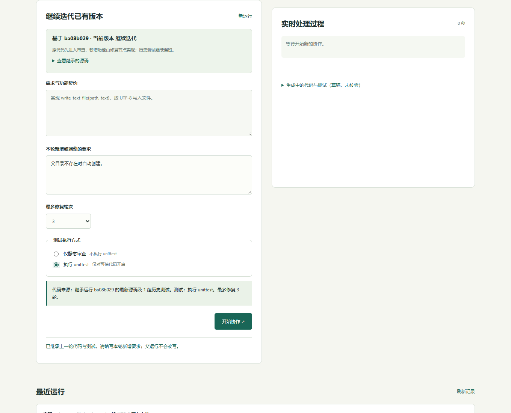
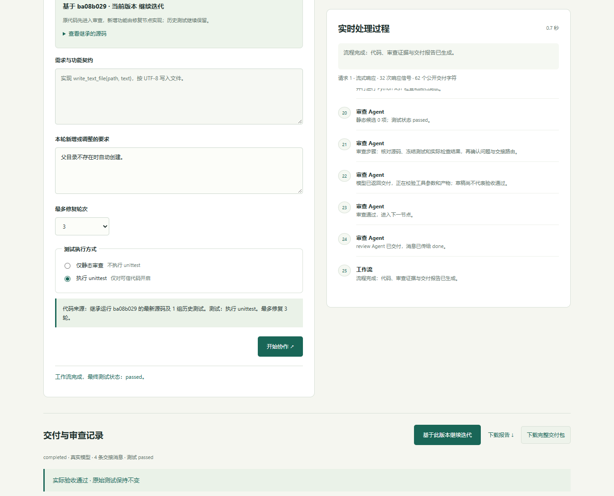

# 测试与复现

2026-10-22 在 Windows、Python 3.13 和 Edge 完成检查。应用只依赖 Python 标准库；浏览器与录屏工具属于本机开发环境。

| 检查 | 结果 |
| --- | --- |
| 单元与集成测试 | 74 项通过 |
| 工作流验收场景 | 10/10 预期行为通过，包括预算终止、失败恢复、实测否决和未运行测试 |
| 跨运行继承 | 继承源码原文，先审查旧代码；新增测试失败后修复；旧测试与新增测试共同通过 |
| 多轮继承与下载 | 第二代仍保留前两轮测试，导出后在独立目录重跑通过；父记录没有改写 |
| 兼容与完整性 | 旧检查点可读取，继承源码或测试哈希不一致时拒绝使用 |
| 浏览器 | 100 条等待事件显示为 5 个关键步骤，无重复编号；继承、重置、测试选项、停止、目录、文件创建与窄屏检查通过，无 JavaScript 错误 |

复现命令：

```powershell
python -m unittest discover -s tests -v
python -m unittest discover -s examples/fixed -v
python -m agentcoder evaluate --output artifacts/evaluation.json
node -e "for (const f of ['app.js','studio.js','workspace.js','continuation.js','markdown.js']) require('node:child_process').execFileSync(process.execPath,['--check','agentcoder/static/'+f],{stdio:'inherit'});"
```

持续集成覆盖 Linux / Windows × Python 3.10 / 3.13，实际结果与产物见 [GitHub Actions](https://github.com/dankingzzzing/AgentCoder/actions)。

自动测试与本轮浏览器检查使用受控 Provider 或本机兼容 HTTP 服务，不调用付费模型，也不构成模型能力评测。此前真实接口运行单独保存在 [原始验证报告](samples/real-workflow-report.md) 与 [文本统计报告](samples/iteration-real-report.md)，没有并入本轮测试计数。





静态模式明确显示 `not_run`，不会宣称测试通过。完整进度事件保留在本机状态，界面只折叠等待事件。停止行为、网络回退和目录边界见 [可靠性说明](RELIABILITY.md)。
