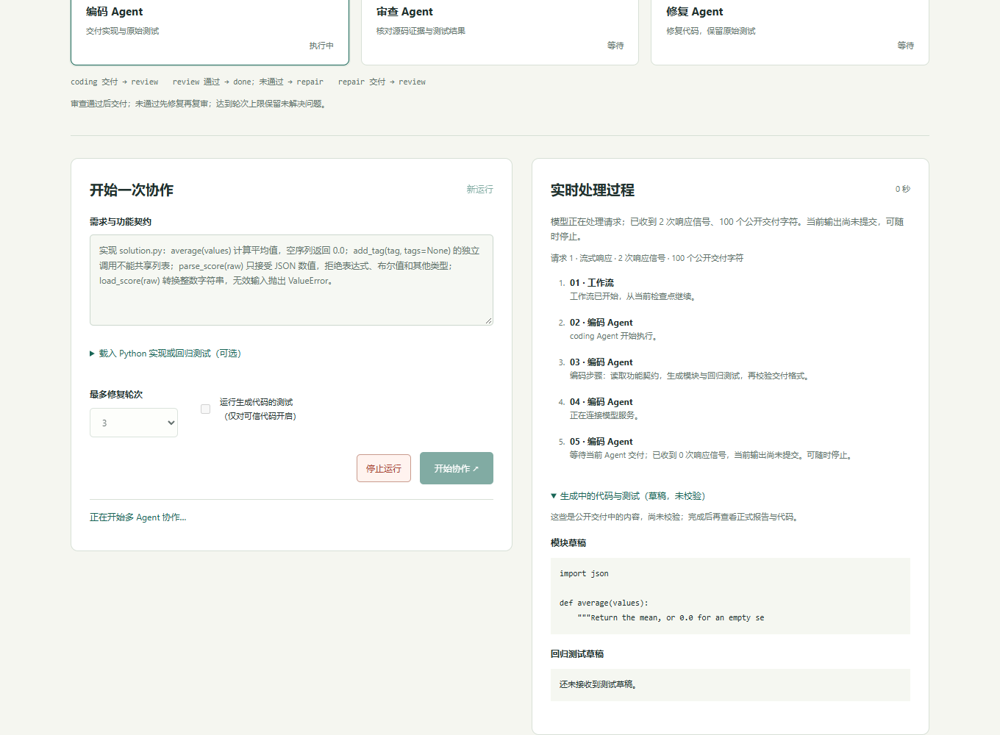
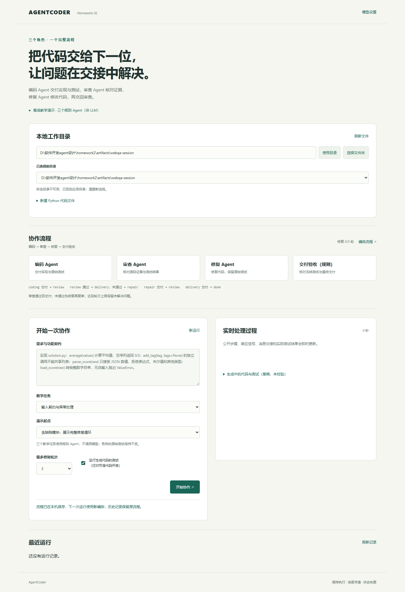
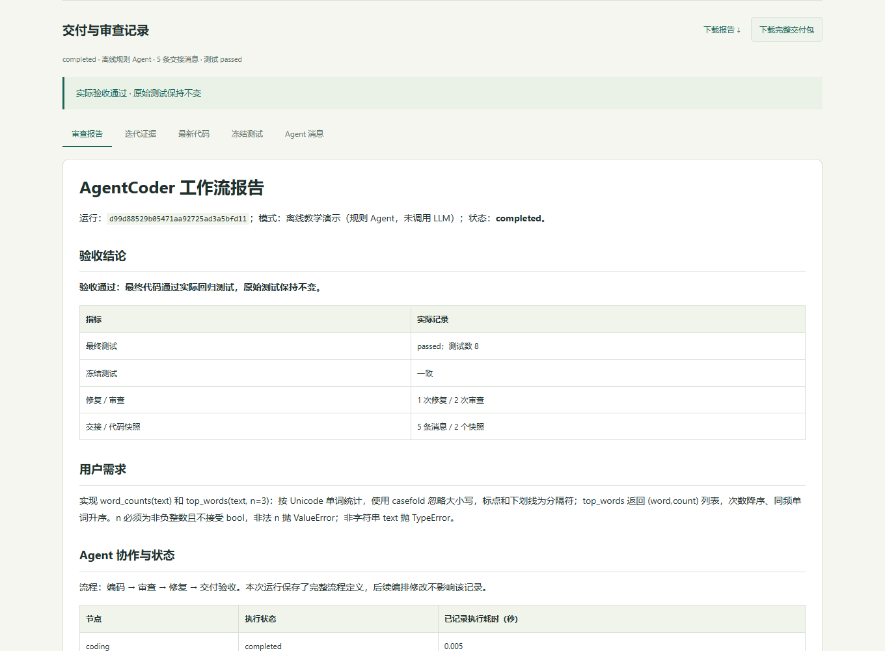

# 交付验证记录

## 2026-10-13 可靠性与本地目录修复

本轮单元与集成测试为 69 项。新增覆盖：等待响应头和中途停顿的取消、测试进程树停止、网络错误分类、SSE 最后一帧、普通 JSON 兼容、当前节点重试与普通响应回退、公开草稿保留、目录持久化、排他创建、回归测试输入与原导入模块名交付。

实际 Edge 操作验证目录选择、新建文件、冲突拒绝、刷新恢复、公开草稿、停止、按钮光标、所选目录输出和 390 像素布局，页面无 JavaScript 错误。受控 HTTP 服务的停止操作约 0.2 秒，等待真实响应数据时可执行；该数据是本机测试，不代表服务商终止云端计算的耗时。

用户失败记录已恢复到 completed：先核对完整返回的模型草稿，再把原先误当源码的 calculator 测试文件识别为冻结回归测试，交付对应实现并完成真实模型复审。原设置没有开启工作流测试，报告保留 not_run；另在独立目录执行原始六项测试，6/6 通过，原始测试逐字保持。普通源码和测试输入的原始文件都没有自动覆盖。

网络、模型密钥和目录设置只保存在本机。公开页面、文档与打包脚本采用通用项目标识，个人备份包名仅由本机参数传入。运行检查点和用户选择的目录路径没有上传。设计边界见 [RELIABILITY.md](RELIABILITY.md)。

日期：2026-10-11（Asia/Shanghai）。本机 Windows、Python 3.13、Microsoft Edge；应用仅使用标准库。浏览器、录屏与对话框检查工具放在忽略的开发目录，不属于运行依赖。

## 2026-10-13 迭代补充

本轮使用 Windows、Python 3.13.9、Edge 实际验证。新功能与自动验收说明见 [迭代记录](ITERATION.md)。

| 检查 | 实际结果 |
| --- | --- |
| 单元与集成测试 | 54 项全部通过，包含旧检查点兼容、快照篡改拒绝、只读观察节点、错误批准否决、两种断连检查点、无修复分支终止 |
| 十个离线验收场景 | 10/10 预期行为通过；三类任务各八个实际回归测试；包含预期 exhausted 和 unverified 的场景 |
| 网页编排 | 模板、校验、保存、刷新恢复、非法路由拒绝；历史图保留 |
| 版本回放与交付 | 原始 / 修复代码可切换、差异显示、failed → passed 对比、自动回放、下载单次 ZIP |
| 浏览器兼容与布局 | 三种任务、正确模块跳过修复、390 像素布局无横向溢出、浏览器存储无凭据、无 JavaScript 错误 |
| 新增真实模型验证 | deepseek-v4-flash-0731；文本统计原始模块保留；21 个冻结测试；6 个首轮确认问题；一次修复后 21/21 通过 |

真实验证运行 `3dd350c3465144a2a3b82988680064b9`，263.21 秒、5 条交接消息、2 个源码快照；最终进入新增交付验收规则节点。角色摘要与实际结果分别标明，完整证据见 [新真实报告](samples/iteration-real-report.md)。旧真实运行的 32 个测试结果属于 2026-10-11 的独立运行，没有合并统计。

离线输出见 [evaluation.md](samples/evaluation.md) 与 [evaluation.json](samples/evaluation.json)。远程 CI 每次重跑并上传证据，以当前 GitHub Actions 结果为准。

## 自动与端到端检查

| 检查 | 实际结果 |
| --- | --- |
| 项目单元与集成测试 | 37 项全部通过 |
| 修复示例 unittest | 8 项全部通过 |
| 缺陷演示 | 三个节点全部执行；一轮修复后原始八测试通过 |
| 正确演示 | 编码与审查通过，修复节点 skipped |
| 有界循环 | 无效修复达到预算后 exhausted，不宣称通过 |
| 失败恢复 | 从审查检查点恢复，编码只执行一次，原始测试一致 |
| 可扩展性 | 注册第四个审计观察 Agent，调整 JSON 路由后真正执行 |
| 实际测试门禁 | 模型声称 approve 时，实际失败仍触发修复 |
| 源码证据 | 多行和格式化引文核验、唯一位置校正、不存在的引文拒绝 |
| 原生接口 | 两种协议、SSE、工具参数分片、强制工具选择、脱敏与重试 |
| 资源与边界 | 超时、无测试、环境过滤、敏感目录、非法 ID、冻结测试、请求上限 |
| 模型设置 | 加密保存、重启恢复、失败验证保留成功配置、密钥不回显 |
| JavaScript | app.js 与 markdown.js 语法检查通过 |
| 作业 1 移动后回归 | 74 项：73 通过、1 个 Windows 符号链接权限跳过；Git 工作区干净 |

自动测试使用受控 Provider 或本机 HTTP 服务，不携带个人密钥。GitHub Actions 配置 Linux / Windows × Python 3.10 / 3.13；远程结果以仓库 Actions 为准。

## 真实模型检查

使用用户已有本机配置的 `deepseek-v4-flash-0731`、Chat Completions 接口，先验证工具调用与结果回传，再执行三个独立角色。

编码 Agent 保留原始缺陷模块并生成 32 个回归测试。首轮审查接受四个源码证据支持的问题，实际测试失败；第一次修复漏了 `json` 导入，测试再次失败，流程没有接受修复声明作为通过事实。复审引文最初含有说明和错误文本，验证拒绝并保存检查点；随后只提取和核验真实源码片段，从当前节点恢复。

第二次修复补齐导入，原始 32 个测试全部通过。三轮审查测试状态为 `failed → failed → passed`，问题数量为 `4 → 1 → 0`；两轮修复，编码交接消息只有一条，原始测试逐字保持不变。成功恢复阶段约 103 秒，耗时随模型与服务变化。

检查时先静态核对生成的测试与修复模块，排除命令、文件和动态执行调用后再运行。证据见 [真实工作流报告](samples/real-workflow-report.md)。个人密钥不进入源码、样例或提交包。

## 浏览器检查

实际通过 Edge 验证完整循环、直接通过分支、代码/冻结测试/消息标签页、Markdown 表格、报告下载、刷新配置恢复、历史读取、390 像素布局、HTML 和危险链接不执行，页面无 JavaScript 错误。

从失败记录点击恢复后，审查和修复完成，编码消息没有增加；新运行重置节点。Windows 系统文件对话框选中示例后，网页读入原模块，原文件保持不变。NDJSON 首帧早于节点完成、停止后恢复也有集成测试覆盖。

消息截图：[agent-messages.png](assets/agent-messages.png)。

## 演示与打包

实际浏览器录像为 H.264 MP4、48 秒、无配音，展示三类角色、失败测试、修复复审、代码、消息与直接通过分支：[demo.mp4](assets/demo.mp4)。

提交脚本排除 `.env`、`.agentcoder`、开发工具、缓存和构建目录，检查 ZIP 完整性及小于 200 MB；wheel 包含全部 HTML/CSS/JS。规则演示和真实模型验证分别标注。
